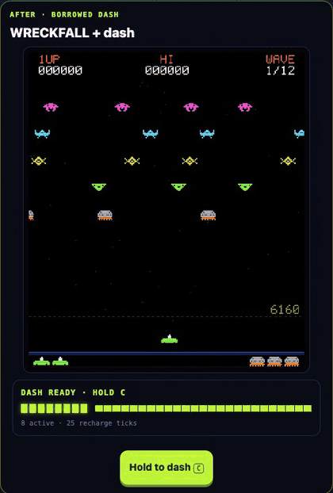

# Motion Transfer

[](https://github.com/rl7x/meta-ai-developer-hackathon/actions/workflows/frontend.yml)

**Recover a move from a compiled game, then port it into games the model has never seen.**

Muse Wonder rebuilt Dashy Dango's dash from the compiled WebAssembly game. It succeeded in 1 of 3 full sessions at first, and in 2 of 3 fresh sessions after we improved the harness. Muse Spark then wrote the code that connects that dash to a game, and ported it into 7 of 8 eligible games it had never seen. It's for game developers who want a mechanic from a game whose source they don't have, and for keeping behavior alive when only the binary survives.



**[Play it live](https://motion-transfer-rl7x.vercel.app)** · [Architecture](docs/architecture.md) · [Port results](docs/auto-port-results.md)

Hackathon problem statement: **Push the Frontier**. Models used through the Meta Model API: Muse Wonder 1.0 and Muse Spark 1.3.

## What it does

| Claim | Measured result | Evidence |
| --- | --- | --- |
| Recover a behavior from a binary | Accepted in 1 of 3 full sessions. The first scored 0/13, 11/13, then 13/13 and passed all 20 separate acceptance checks. Both frozen repeats were rejected. On an improved harness, 2 of 3 fresh sessions passed 32/32 and 20/20 | [Recovery record](docs/fresh-recovery.md) · [Repeat trials](docs/wonder-repeat-results.md) · [Harness results](docs/wonder-harness-results.md) |
| Port it into unseen games | 7 of 8 eligible games, 2 excluded up front, $0.33 estimated | [Port results](docs/auto-port-results.md) |
| Remix it from a sentence | 8/9 positive tasks passed, and the deliberately impossible task was correctly refused | [Task results](docs/live-mechanics-results.md) |

People chose the motion to recover and wrote the checks. The models wrote the controller, the adapters and the patches, and nothing they write is trusted on its word. Generated code runs in an isolated worker with no network or credentials, and the port and remix campaigns were frozen before their first request. Failures stay on the record, so these results are not a general reliability estimate. Run `npm run verify:evidence` to recompute them from committed files, without a model request.

## Try it

On [the live site](https://motion-transfer-rl7x.vercel.app) you can play Dashy Dango itself, play the dash in each game, and read exactly what Spark wrote for every saved version. Remixing PARALLAXIA from a sentence took about 12 seconds in the measured run, and every checked version stays in a shared library that replays without a model request.

To run it locally, see [running it, measured results and limits](docs/running-and-limits.md).

## Use it on your own game

```sh
npm run port -- ./my-game --core game.js --allow-paid
```

Muse Spark reads the file that moves your player and writes the patches, and you get a patched copy with the dash on X. Your original game is not changed. It needs a game that runs from a static `index.html` with a canvas, and a `MODEL_API_KEY`. Each attempt is capped at $0.25, with at most two attempts, and generated code only runs in a browser page.

The command checks that the patches apply, the page runs and the dash fires. It can't prove your game still plays the same, because that takes a driver written for your game, so play it yourself. If something is wrong, send it back:

```sh
npm run port -- ./my-game --core game.js --allow-paid --out ./my-game-v2 --revise ./my-game-dash --note "the dash goes through walls"
```

We tested it on [Tiny Platformer](https://github.com/jakesgordon/javascript-tiny-platformer), an MIT game from outside the campaign. Spark's first port passed every automatic check but went through walls in 632 of 2,007 measured dashes. Two playtest notes brought that to 0, and that lesson now goes out with every request. See [the trial](docs/auto-port-results.md#the-port-command-on-an-outside-game).

## Built during the hackathon

The building period ran from October 27 to November 4, 2026, and this repository's first commit is from October 27. The left column was built in that period.

| Built during the hackathon | Upstream, used under license |
| --- | --- |
| Recovery tooling, evaluators and the recovered controller | Dashy Dango cartridge |
| Adapters, host hooks and the auto-port pipeline | PARALLAXIA, JUJUMP, PAKU PAKU, RDSTR Stunts and the ten auto-port games |
| Isolated verification, spending ledger and publication | WASM-4, crisp-game-lib, three.js and other libraries listed below |
| The web interface, library and hosted backend | |

## Repository guide

| Folder | Contents |
| --- | --- |
| [`web/`](web/) | TypeScript and React workbench, browser entrypoints and local preview server |
| [`src/`](src/) | Agent orchestration, deterministic runtimes, evaluators, recipient integration and hosting |
| [`assets/`](assets/) | Pinned upstream games, recovered components, saved transfers and verification evidence |
| [`scripts/`](scripts/) | Command-line entrypoints used by the npm commands |
| [`tests/`](tests/) | Unit, browser, artifact-integrity and container-isolation checks |
| [`docs/`](docs/) | Architecture, measured results, setup and limitations |
| [`skills/`](skills/) | Repository-local motion-transfer skill |
| [`.github/`](.github/) | GitHub workflows |

Start with the [architecture](docs/architecture.md). Setup details, the spending ledger and remaining limits are in [running it, measured results and limits](docs/running-and-limits.md). Saved game players bundle their engines into standalone HTML; `.gitattributes` identifies these build artifacts and upstream sources so GitHub's language statistics describe the application code.

## Sources and licenses

Every outside source below allows this use, and each copy keeps its upstream notice. This project's own code is under the [MIT License](LICENSE), which does not cover the third-party work listed here. Licenses were checked on November 3, 2026.

Dashy Dango is upstream work by samX500 and willGuimont. PARALLAXIA, JUJUMP and PAKU PAKU are upstream work by Kenta Cho / ABA Games. The RDSTR Stunts car, renderer, track, stunt physics and audio are upstream work by sebayaki. Recovery tooling, recovered controllers, adapters, host hooks, deterministic experiments, composition and verification are the added project work. Each export retains its upstream notices.

### Games

| Source | Used for | Author | License | Notice in this repository |
| --- | --- | --- | --- | --- |
| [Dashy Dango](https://github.com/willGuimont/dashy-dango) at `9b899e8` | Compiled cartridge the dash was recovered from | samX500, willGuimont | ISC | [NOTICE.txt](assets/targets/dashy-dango/NOTICE.txt) |
| [PARALLAXIA](https://github.com/abagames/agentic-gamedev-games) at `f30b52a` | Live remix game | Kenta Cho / ABA Games | MIT | [LICENSE](assets/recipients/parallaxia/upstream/LICENSE) |
| [JUJUMP](https://github.com/abagames/crisp-game-lib-games) | Saved transfer | Kenta Cho / ABA Games | MIT | [LICENSE.txt](assets/recipients/jujump/upstream/LICENSE.txt) |
| [PAKU PAKU](https://github.com/abagames/crisp-game-lib-11-games) | Saved transfer | Kenta Cho / ABA Games | MIT | [LICENSE.txt](assets/recipients/paku-paku/upstream/LICENSE.txt) |
| [RDSTR Stunts](https://github.com/sebayaki/roadster) at `8486687` | Saved transfer | sebayaki | MIT | [LICENSE](assets/recipients/roadster/upstream/LICENSE) |
| [BLINK SCOPE, DRAFT LINE, HEAD RUSH, OVERTURN, PILEUP, SKYHAUL, TWIN VECTOR, UNDERTOW, WRECKFALL and ZIG SABER](https://github.com/abagames/agentic-gamedev-games) at `f30b52a` | Unseen games for the auto-port campaign | Kenta Cho / ABA Games | MIT | [LICENSE](assets/auto-port/LICENSE) |
| [Tiny Platformer](https://github.com/jakesgordon/javascript-tiny-platformer) at `50cbd06` | Outside test of `npm run port` | Jake Gordon and contributors | MIT | [LICENSE](assets/port-example/tiny-platformer/LICENSE) |

The Dashy Dango repository has no `LICENSE` file, so GitHub shows no license for it. The authors declare ISC in the `wapm.toml` at the pinned revision and in the [Wasmer package](https://wasmer.io/willguimont/dashy-dango), and that package's cartridge is byte-identical to the one used here.

### Libraries shipped to players

| Library | Used for | License |
| --- | --- | --- |
| [WASM-4](https://github.com/aduros/wasm4) 2.7.1 | Runs the Dashy Dango cartridge | ISC |
| [crisp-game-lib](https://github.com/abagames/crisp-game-lib) 1.1.1 | JUJUMP and PAKU PAKU runtime | MIT |
| [sounds-some-sounds](https://github.com/abagames/sounds-some-sounds) 3.0.0 | JUJUMP and PAKU PAKU audio | MIT |
| [three.js](https://github.com/mrdoob/three.js) 0.186.1 | RDSTR Stunts rendering | MIT |
| [FPSMeter](https://github.com/Darsain/fpsmeter) 0.3.1 | Bundled with Tiny Platformer | MIT |
| [React and React DOM](https://github.com/facebook/react) 19.3.1 | Web interface | MIT |

### Tools used to build, test and host

These are not shipped to players.

| Tool | Used for | License |
| --- | --- | --- |
| [WABT](https://github.com/WebAssembly/wabt) 1.0.39 | Decompiling the cartridge for recovery evidence | Apache-2.0 |
| [quickjs-emscripten](https://github.com/justjake/quickjs-emscripten) 0.32.0 | Running generated code in the evaluator | MIT |
| [Playwright](https://github.com/microsoft/playwright) 1.64.1 | Browser verification | Apache-2.0 |
| [TypeScript](https://github.com/microsoft/TypeScript) 6.0.3 | Type checking and adapter compilation | Apache-2.0 |
| [esbuild](https://github.com/evanw/esbuild) 0.28.2 | Bundling | MIT |
| [ESLint](https://github.com/eslint/eslint) 10.14.0, [typescript-eslint](https://github.com/typescript-eslint/typescript-eslint) 8.72.1, [Prettier](https://github.com/prettier/prettier) 3.9.10 | Linting and formatting | MIT |
| [@vercel/sandbox](https://www.npmjs.com/package/@vercel/sandbox) 3.9.1 | Hosted backend and verifier microVMs | Apache-2.0 |

Every other installed npm package is MIT, ISC, Apache-2.0, BSD or BlueOak-1.0.0, except `caniuse-lite` (CC-BY-4.0). That one comes in through the lint tooling and is not shipped.

### Hosted services

Muse Wonder 1.0 and Muse Spark 1.3 are used through the [Meta Model API](https://dev.meta.ai/products/meta-model-api), and the site runs on [Vercel](https://vercel.com). Both are used under their service terms. They are not open-source components of this repository.

### Design inspiration

The pixel-art look was inspired by [moa](https://trymoa.work). Its [repository](https://github.com/petersenmatthew/moa) has no license, so none of its code or assets are used here.
