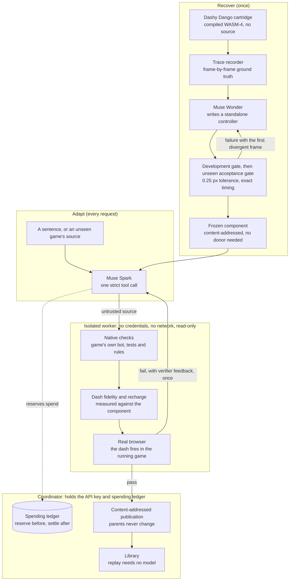

# Architecture

Motion Transfer recovers one behavior from a compiled game, then lets Meta's models connect it to other games. Nothing a model writes is trusted until an isolated worker has measured it.

## Trust boundaries

- **Model output is untrusted.** Generated adapters and patches run only inside the worker, with no credentials, no network and a read-only filesystem. A capability gate rejects forbidden calls first, but the worker is the real boundary.
- **The measuring code is not generated.** Drivers, the host runtime and the verifier are written by hand and frozen by hash before a campaign starts, so a model cannot change how it is graded.
- **The worker never holds the key.** It refuses to run if credentials appear in its environment.
- **Publication is content-addressed.** A version's identity is the hash of its bytes, and a parent never changes when a child is published.

## Spending

Every Meta call reserves its full ceiling on the shared ledger first, then settles measured usage. If a call fails in a way that may still have billed, its whole ceiling stays held. The ledger has one owner at a time. It lives with the hosted backend, so campaigns send their model calls there rather than spending from a second copy.

## Where things live

| Folder | Status | Contents |
| --- | --- | --- |
| `web/app/` | Current | React interface |
| `src/auto-port/` | Current | Porting unseen games: drivers, host runtime, verifier, Spark request |
| `src/parallaxia/`, `src/hosting/`, `src/evaluator/` | Current | PARALLAXIA integration, coordinator, isolated worker and gates |
| `src/agent/`, `src/campaign/` | Current | Recovery agent, Meta client, spending ledger |
| `assets/evidence/` | Current | Small derived results that `npm run verify:evidence` checks |
| `assets/auto-port/` | Current | Pinned games and published ports |
| `src/roadster/`, `assets/transfers/paku-paku/`, `assets/benchmark/` | Historical | Earlier transfers and the fidelity study, kept as evidence |
