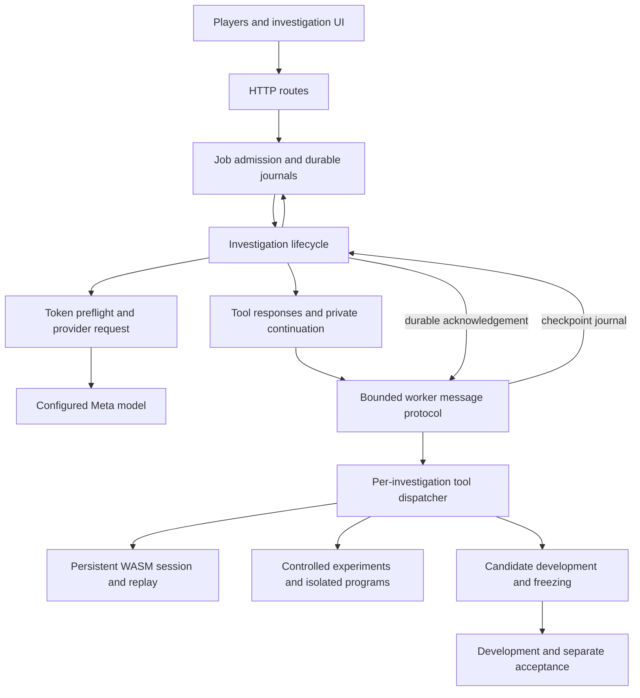

# Backend architecture

The application has a browser experience, a trusted Node coordinator and a credential-free investigation worker. The worker owns a persistent cartridge session. Agent experiment programs run inside the existing isolated QuickJS interpreter, with bounded JSON capabilities; the child process alone is not their security boundary.



## Investigation coordination

`agent/investigate.mjs` owns the public investigation entry point, validates initial/resumed reports, creates one worker, runs bounded turns and closes the worker on completion or failure. Its default exports, report shape and caller callbacks are preserved.

- `investigation-request.mjs` owns request construction, token preflight, context compaction, durable reservations, usage settlement and stateless response continuation. The existing instructions and provider request bytes are preserved. A reservation is recorded before generation; missing usage or interrupted transport retains unknown billing and stops without retry.
- `investigation-tools.mjs` owns tool call identity, namespace routing, experiment numbering, model-visible outputs, image delivery and error feedback. Failed forks return occupied branch and checkpoint identities so the next model action can respond to the actual failure. Private reasoning remains in continuation history; the public report does not record its encrypted payload.
- `investigation-completion.mjs` applies the existing evidence requirements. It distinguishes orientation, function-body inspection, cited controlled trials, subsequent model decisions and separately accepted components. Listing functions cannot satisfy code inspection. Freezing cannot satisfy acceptance.

The HTTP endpoints and schemas remain unchanged. `lab/service.mjs` validates and serializes jobs, retains idempotency, holds admission during asynchronous parent lookup and journal writes, redacts credentials and accounts for settled and reserved spending across restarts. The existing PAKU remix service and its separate journal remain in place.

## Worker ownership and durability

`agent/tools.mjs` starts one persistent child with a restricted environment, bounded input/output, per-command cancellation and deadlines, and clean shutdown. API credentials remain in the parent coordinator.

`agent/tool-worker.mjs` handles line-delimited JSON, sequential commands and checkpoint acknowledgements. Acknowledgements bypass the ordinary command queue because the current command may be waiting for the parent to persist its checkpoint. Both response and checkpoint message formats are unchanged.

`agent/tool-dispatcher.mjs` owns one investigation's lazy session, static-analysis cache, experiment workbench and component workbench. Static orientation can run before a live session exists. Multiple dispatcher instances have separate state. The dispatcher delegates runtime execution, WABT analysis, writer tracing, images and component evaluation to the existing modules, retaining their validation and limits.

Runtime checkpoint identities bind the cartridge and host source. Experiment journals additionally bind the experiment engine source. Those identity-bound files were left byte-for-byte unchanged in this refactor, allowing prior journals and evidence to remain usable. A future engine change needs an explicit compatibility decision; changing recorded hashes does not establish compatibility.

## Source and playable artifacts

The repository retains immutable, self-contained Roadster players for saved versions. Three bundles contain 2,615,119 HTML-file bytes, including embedded JavaScript, styles and assets. They account for approximately 98.6% of tracked HTML bytes in the audited implementation; the main web interface HTML is approximately 24 KB.

`.gitattributes` marks only those bundled players as `linguist-generated` and pinned `recipients/*/upstream/**` trees as `linguist-vendored`. Recovered component and adapter source remains visible. Existing upstream line-ending attributes are retained. This follows [GitHub's generated/vendor classification](https://github.com/github-linguist/linguist/blob/master/docs/overrides.md); it does not relabel HTML as another language. GitHub refreshes its cached statistics after changes reach the default branch.

## Verification

```sh
node --test tests/investigation-contract.test.mjs tests/investigation-completion.test.mjs tests/tool-dispatcher.test.mjs tests/lab-service.test.mjs
npm test
```

The injected-client contract was captured from implementation `1dbbab6` before the refactor. It compares request hashes, private continuation handling, dispatch arguments, update order, public reports and accounting for successful native discovery, uncertain transport and missing usage. Timestamps are excluded from comparison. No provider is called.

Actual runtime tests cover persistent state, checkpoint replay, branch isolation, interrupted evidence persistence, the occupied-branch failure, selected images and sandbox limits. Browser tests cover players, mobile controls, existing remixes and the independent JUJUMP download. Saved failed investigations retain their original outcome; this refactor adds no recovery claim or paid inference.
