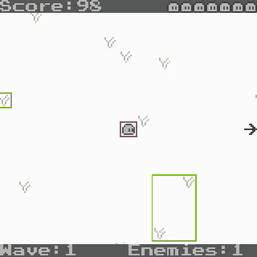

# Recovering a move from footage

**From a gameplay clip alone, SAM 3.1 and Muse Spark Open rebuilt Dashy Dango's dash. With the final checks, 4 of 6 fresh sessions scored 40/40 on the same exam the binary recovery passed, and the other 2 were refused.** No source, no binary and no record of the buttons. Every controller the tool accepted in that run was perfect, but six sessions is a small sample, and the [earlier runs](#results) did worse.



## How it works

1. **Find landmarks.** Plain image code picks small objects in a frame, such as tufts of grass. No model is involved.
2. **Track them.** SAM 3.1 follows each one through the clip from a point prompt. Text prompts like "character" found nothing in this tiny pixel art, but a point on the object works without SAM needing to know what it is.
3. **Work out the player's motion.** Dashy Dango's camera follows the player, so the player stays still on screen and the world moves instead. The player's motion is the opposite of how the scenery moves. The largest group of landmarks that agree decides each step, because identical scenery can make a tracker jump from one piece to the next.
4. **Find the bursts.** Runs of frames much faster than ordinary movement count as bursts, and only bursts seen whole are kept. Every other burst is held back.
5. **Write a controller.** Muse Spark Open sees numbers from the practice bursts, and nothing else.
6. **Check it.** The controller runs in the same sandbox as every other generated controller. It's checked against the held-back bursts, walking speed, a dash with no direction held after moving, the shortest repeat gap and the first burst. A mismatch goes back to the model, up to 3 attempts in all. If nothing passes, nothing is saved.

The same steps work with a fixed camera. Then the scenery stays still and the player's own motion on screen is the answer. The scenery decides which case it is. If it scrolls and the player keeps returning to one spot on screen, the camera is following.

## Results

Every run was frozen and committed before its first model request. Each exam seed was created after its controller was frozen, and the model never saw the exam, the true positions or a button log. The rules changed between rows, so each row stands alone.

| Run | What changed | Sessions | 40-trace exam |
| --- | --- | ---: | --- |
| v1 | First attempt | 1 | Not reached: no controller passed the footage checks |
| v2 | Shorter tracking sections, new clip | 1 | 2 |
| v3 and repeats | Exact timing checks, new clip | 6 | 40, 40, 40, 16, 14, 0 |
| **Final repeats** | **Checks for walking and dashes with no direction held** | **6** | **40, 40, 40, 40, and 2 refused** |

For comparison, the same grader gave 0/40 to a contact sheet with four timing numbers supplied, and 40/40 to the compiled binary.

The final row matters most. The earlier run scored 16, 14 and 0 on controllers that had passed every footage check, so someone using the tool on their own clip, with no exam to catch it, would have got a wrong answer and no warning. With the final checks, every accepted controller was perfect. Two sessions used all 3 attempts without passing, and the tool saved nothing.

In the v3 clip, the worst error across 763 measured frames was 1.35 pixels. Its accepted controller recovered all four values exactly:

| Value | From footage | Real game |
| --- | ---: | ---: |
| Walking speed | 2 | 2 |
| Dash distance | 60 | 60 |
| Recharge | 25 | 25 |
| First dash available after | 10 | 10 |

`npm run verify:evidence` reruns the v3 exam from the committed controller, and `tests/footage-evidence.test.mjs` reruns every other session.

## Why it took so many runs

**v1 failed because of the tracker.** Sections of 120 frames lost their landmarks when the world scrolled quickly, so only 495 of 724 frames were measured, and bursts reached the model in pieces.

**v2 scored 2/40 because of the checks.** With only its two timers changed by hand, the v2 controller scored 40/40, so its logic was right. Its recharge was one tick too short and our check allowed that, and its clip never showed how soon the dash is first available. That hand change was a diagnostic, not a result. The v2 score stays 2/40.

**v3 fixed those using footage alone.** The recharge check became exact, and a new clip held the dash button from the first moment of play, which shows the delay. It scored 40/40, but that was one run.

**The repeats showed one run proved little.** Five more sessions scored 40, 40, 16, 14 and 0. All five passed the footage checks, so those checks were too weak:

- The diagonal speed we reported came from rounded single frames. It said 1.51 when the truth is 2, and that misled the model.
- Walking speed was never checked.
- A dash with no direction held was replayed with a direction held, so a controller that reused the last direction went unnoticed.

**The final checks fixed those, and we replayed every saved controller through them first.** All three perfect controllers passed, and all four flawed ones were rejected, each for the real reason. Then six new sessions ran under a frozen plan.

## Checks beyond the exam

These ran on the v3 controller, with no model request.

| Check | Result |
| --- | ---: |
| The 12 development traces from the binary recovery | 12/12 |
| The regression trace from the binary recovery | 1/1 |
| 40 traces on each of 5 more random seeds | 200/200 |

## Into a game it has never seen

The recovered move can go straight into the port command. Muse Spark Open put it into Tiny Platformer on the first attempt, for $0.0089, and it fired in a real browser. The existing sweep then measured 2,007 dashes: 0 entered a wall and 0 left the map. With the dash unused, the game matched the original on every tick. Muse Spark 1.3's first port of this game had 632 wall failures, but that was before the lesson from that trial went out with every request, so this isn't a like-for-like comparison.

`tests/footage-port.test.mjs` reproduces these numbers from the saved patches.

## Try it

You need a local 60 fps clip showing the move at least twice, `MODEL_API_KEY` for SAM 3.1 and `BASETEN_API_KEY` for Muse Spark Open.

```sh
npm run recover -- ./clip.mp4 --rights own --source "My Game, my own work" \
  --player 14:322,322 --out ./recovered-move --allow-paid
npm run port -- ./my-game --core game.js --component ./recovered-move --open --allow-paid
```

`--player` is a point on the player: the frame to start from, then its position in that frame. For pixel art, add `--pixel-scale` with the number of video pixels per game pixel. To measure how soon the move is first available, hold its button from the first moment of play and add `--play-start` with that frame number.

The clip needs the move used at least twice, because half the bursts are held back. Holding the button down shows the real recharge time. If nobody ever presses as soon as possible, the recharge can only be as short as the shortest gap in the clip. A dash from a standstill, with no direction held, shows where the move goes by default.

If no controller matches the clip after 3 attempts, the command says so and saves nothing.

## Rights

`--rights` must be `own`, `open-license` or `permission`, and `--source` must say what the game is and who made it. The command refuses to start without them and it won't download clips from the web.

It keeps motion numbers and generated code. It doesn't keep frames, art or sound, and `provenance.json` records only the clip's hash and what you stated. The flag records a claim and can't verify it, so it's your responsibility to use a game you have the right to work with.

## Limits

- **This is a footage match.** It's labeled that way everywhere, and it's a weaker check than the binary recovery on its own. The exam is only possible here because the true game is available. For your own clip, the check is the held-back bursts.
- **A small sample.** Six final sessions, and 2 of them were refused. This isn't a reliability estimate.
- **One game.** Every run used Dashy Dango, the game the tracker was built on. Other games may need more work.
- **A clip made for the job.** It held the button from the start and repeated dashes on purpose. An ordinary clip shows less.
- **Dash-like moves only.** It finds short, fast, straight bursts. It won't recover a jump arc, a combo or anything that depends on hidden game state.
- **The tools were tuned with the exam in view.** We fixed the checks after reading exam failures, so they aren't independent of the exam, even though each seed was new and the model never saw any of it. The final sessions also reused the v3 clip.
- **Some rules can't be seen.** Footage can't show what happens when opposite directions are held together, and we didn't tell the model. A controller can get that wrong and still pass.
- **The camera check changed after the last run.** Running the real command on a short clip showed it could misread a clip full of dashes. We fixed it and tested the fix on that clip and on the saved tracks. The six final sessions weren't rerun afterwards.
- **The prompt helps.** It gives the controller's interface and field names, and it tells the model how to read the numbers. Only the values are left for the model to find.
