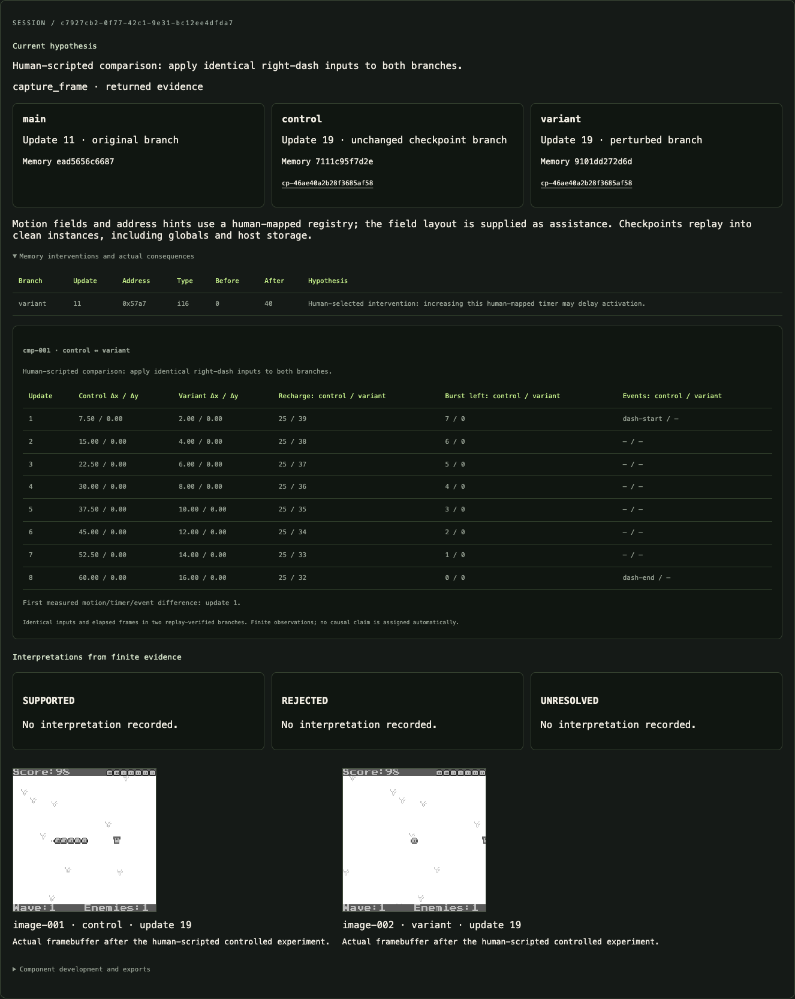

# Stateful compiled-software investigation

The investigation lab lets Muse Spark choose code inspection, input sequences, branches, memory interventions and component candidates. It uses the pinned WASM donor, WABT 1.0.39, the existing deterministic runtime, motion evaluator, package writer and persistent spending journal. It never supplies the saved recovered implementation as an answer to a new recovery.

## Execution and replay

One credential-free child process serves sequential JSON-line commands for an investigation. Its live cartridge instances survive between calls. The parent owns Meta credentials, token preflight, reservations, cancellation and the overall deadline. The worker has a 128 MB V8 heap limit; commands have a ten-second deadline. Cancellation or a stalled command terminates the worker. Results are capped at 32 KB; the internal transport is capped at 4 MB. Arbitrary paths, source files, shell commands and network tools are unavailable to the agent.

| Tool | Evidence or action |
| --- | --- |
| `session_advance` | Continue held inputs on a branch and record actual observations. |
| `session_observe`, `read_memory` | Observe without advancing; optional bounded typed memory watches. |
| `session_reset` | Reinstantiate this branch with fresh globals, memory and empty host storage. |
| `checkpoint_state` | Record the input/edit journal, runtime identity and observed hashes. |
| `fork_checkpoint` | Replay that journal into a new independent experimental branch. |
| `write_memory` | Apply up to eight typed edits to a checkpoint branch, recording old/new values, bytes, frame and hypothesis. Writes to `main` are rejected. |
| `diff_memory` | Compare up to 4,096 bytes between replay-verified observations; return at most 64 changed typed values. |
| `compare_branches` | Advance an unedited control and a perturbed branch using identical inputs and elapsed frames. |
| `run_original` | Retained compatibility tool for a separate fresh controlled rollout. |

Checkpoints are **replay descriptions, not memory snapshots**. A new module instance reconstructs private mutable globals as well as linear memory and host storage. Every journal operation and restored endpoint checks frame, memory, framebuffer, storage and fault status. Cartridge SHA-256, runtime source identity and host implementation hash must match. Hash equality covers these finite observations; it does not prove all hidden state equivalent.

A session allows six branches, sixteen checkpoints, 128 observations, twelve comparisons, and 128 actions / 7,200 advanced updates per branch. One comparison accepts four input segments and 600 updates. Changes caused by a mutation are reported separately from the mutation itself: memory/rendering divergence, normalized movement, cooldown/remaining counters, and observed start/end transitions. The report keeps the original input/edit journals for reconstruction after interruption.

The motion values and optional address hints come from a **human-mapped, hash-guarded registry**. This is assistance, not agent discovery of an allocation layout. The agent chooses the intervention and interpretation. Unlabelled memory changes are candidate fields, not inferred variable identities.

## Static investigation

`inspect_wasm`, `list_functions`, `inspect_function`, `decompile_function` and `call_graph` expose bounded binary information. The agent chooses functions rather than inheriting a recovery function list. Decompilation is approximate C-like WABT output; WAT remains authoritative. Generated names and agent-inferred annotations have different name sources. Direct graph navigation is capped at sixty nodes, one hundred edges and depth three. Indirect calls remain unresolved.

`annotate_function` and `record_finding` retain hypotheses, confidence, supported/rejected/unresolved interpretation, and actual evidence IDs. Citations must exist in the session. These classifications remain model interpretations of finite evidence.

Static load/store offsets are added to a runtime base address. They are not automatically absolute memory addresses. A current pointer can change between instances or allocations.

### Scalar writer tracing

`trace_writers` builds a **separate analysis copy**. WABT reassembly adds callbacks around executed scalar integer/float stores while retaining references to original function indices and WAT lines. The original artifact stays immutable. Both copies replay the checkpoint and execute the same inputs; memory, framebuffer, storage, draw calls and tones are compared every update.

At most 120 updates, 250,000 callbacks and 64 matching hits are allowed. The result binds attribution to the analysis copy, range, inputs and behavioral comparison. It reports effective runtime addresses, store widths and original function/line references. Writer attribution is qualified by the finite comparison result.

This is not a pausing watchpoint or a general debugger. Host-import writes, bulk memory operations, SIMD and atomic writes are not traced. Unsupported instructions are disclosed. A lack of hits does not establish that a range is never written.

## Visual evidence

`capture_frame` encodes the actual 160×160 framebuffer and current palette as PNG, retaining session, branch, frame, observation and SHA-256 identities. Four selective captures are allowed per investigation. Selected images are passed as `input_image` blocks with a base64 `image_url` string, alongside structured measurements, using the [Meta image-input protocol](https://dev.meta.ai/docs/image-understanding). Token-count preflight includes the images.

The lab preserves PNGs and replay journals under ignored `reports/lab/sessions/<session-id>/`. Reports also contain the image data and identity. Images are not captured on every update, and loading saved recordings makes no inference request.

## From evidence to a component

1. `select_component_evidence` chooses previously inspected functions and actual session execution evidence. The host supplies the motion boundary and ABI, not an implementation.
2. `submit_component_candidate` compiles standalone TypeScript and runs existing development rollouts plus the declared motion regression. Source cannot import the donor, other modules, networking or a runtime. Three candidate attempts are allowed.
3. Actual development feedback includes the first divergence. Closed-loop float32 positions use the existing 0.25-pixel tolerance; normalized cooldown, remaining counters and events must agree exactly. The candidate declares its timer state field names.
4. `freeze_component` binds exact source, build, contract and timer mapping after development passes. No subsequent selection or repair is allowed.
5. A separate `accept_component` call generates twenty acceptance rollouts after freezing. Acceptance failure is final for this investigation and cannot feed another repair. Passing source is exported through the existing component package writer with contract, evidence and verification.

Accepted packages live under `reports/lab/sessions/<session-id>/components/<candidate-id>/`. They do not replace existing frozen components or silently enter a playable destination. Recipient-specific adapter, collision, clock and browser invariants still apply before transferring a new candidate. Existing transfers, children, lineage and source exports remain separate and usable.

## Spending and scope

The new memory investigation allows twelve generation requests / twenty-four tools; extraction allows sixteen / twenty-four. Both retain the **$0.50 run cap**, the existing persistent **$10 lab ceiling**, one active task, token preflight, durable reservations, unknown-billing blocks and no automatic retries. Legacy questions retain six requests / twelve tools. More available tools do not cause API calls on page load.

The UI shows the current hypothesis/action, session and branches, edits, comparisons, interpretations, images and development feedback. Saved recordings, completed runs and fresh activity have different labels. A completed investigation must cite actual contrasting execution evidence; the memory workflow additionally requires code inspection and a controlled branch perturbation. Extraction remains incomplete unless the new candidate passes separate acceptance.

Interrupted reports retain their replay state. The existing explicit report-resume path reconstructs the worker before further inference and retains original run limits. Unsettled usage blocks resumption; paid work is never resumed automatically. Runtime/cartridge changes reject old checkpoints instead of silently treating them as compatible.

The target and motion boundary are deliberately narrow. Human field mapping, ABI and evaluators are disclosed. Finite behavioral comparisons and acceptance do not establish universal program equivalence, automatic extraction from arbitrary software, or validity in a different recipient.

## Recorded validation

`npm test` passes 127 local tests. These include private-global/storage replay, branch isolation, actual donor timer intervention, typed writes, mutation comparison, error/cancellation behavior, writer-copy behavioral agreement, PNG decoding/model input, development feedback, separate freezing/acceptance, immutable publication, desktop/mobile UI, and the existing playable transfers and remix flows. Injected model/evaluator fixtures are explicitly labelled; they do not claim live recovery.

`npm run verify:motion` replays the existing frozen component over 53 traces / 6,744 updates with zero measured position error and exact ownership/events. This reuses frozen evaluation inputs. The unchanged PAKU adapter passed eleven mapping cases / eight browser checks under the new host receipt. `npm run tools:smoke` passes without inference.

The one new live Spark investigation cost **$0.252143**, with twelve generation requests and zero unsettled reservation. It chose function inspection, started/moved the donor, observed +60 world-x units, and restored a checkpoint into `ctrl`. It repeatedly requested an occupied branch name and **did not complete the required perturbation comparison**. The completion gate rejected the run; no new component was submitted or accepted. The ambiguous creation-name description was fixed and tested locally without a second paid run.

The UI's **View recorded branch exploration · incomplete** button loads the original settled failure, public final interpretation and replay journal without inference. The checkpoint was independently reconstructed locally at frame 70 with the same recorded hash. The separate successful neutral-direction recording remains available. Failed exploration is retained as evidence, not presented as a successful discovery.

**View local control experiment · no model** shows a separate human-scripted verification with actual donor execution: over eight identical inputs, the unchanged control moves 60 source pixels while the timer-edited variant moves 16. It retains two actual framebuffer PNGs. The timer allocation relocates between updates; tracing its checkpoint address finds zero matching stores, while tracing the observed endpoint address finds six. Both analysis-copy comparisons match the original. This is a local systems demonstration, not a Meta-generated investigation or independent field discovery.

Reproduce the complete local control, memory diff, writer traces, code inspection, images and journal without any API key:

```sh
npm run tools:session-smoke
```

This writes `reports/investigation-toolset-smoke.json` and PNG/journal evidence under `reports/investigation-local/`. It does not alter the lab spending journal, saved recordings or frozen demo components.


